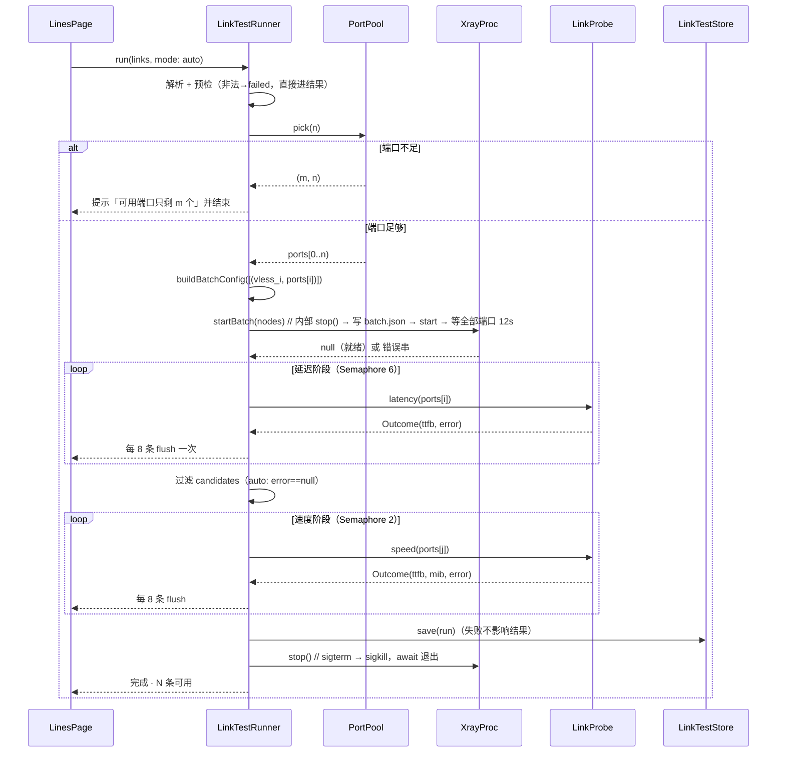
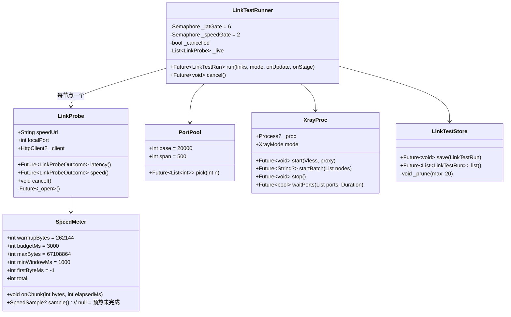
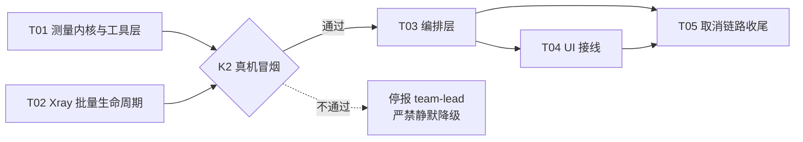

# 链路测速对齐 Kotlin 版：设计方案

> 目标工程：`D:/cytest-flutter`（Flutter，minSdk 29 / arm64 单 ABI）
> 对照工程：`D:/cytest-app`（Android Kotlin，111 个 `.kt`）
> 结论先行：**Flutter 现在的「测试全部线路」测的不是延迟，是 Xray 进程启动耗时**，语义与 Kotlin 完全不同，必须重写测量内核，并沿用已有的多入站批量方案。

---

## 0. 问题定性（已核实）

`lib/ui/pages/lines_page.dart:85-99` 当前实现：

```dart
for (final link in links) {
  final started = DateTime.now();
  await state.xray.start(v);                       // 起进程 + 等端口监听
  rows.add(('${v.host}:${v.port}',
      '${DateTime.now().difference(started).inMilliseconds} ms'));
}
```

它 `await` 的是 `XrayProc.start()`（`lib/data/xray.dart:266-338`），该方法内部依次做：`stop()` → `Bins.path()` → `freePort()` → **`checkXrayBinary()` 跑一次 `xray version`（最多 3s）** → 写配置 → `Process.start()` → `waitPort()` 轮询端口。

因此这个「ms」= **二进制自检 + 进程冷启动 + 配置解析 + 端口监听**的耗时，实测在 150~800ms 区间，且：

1. **与真实网络延迟无相关性**：它不发起任何到目标站点的请求，只测本机起进程。用户拿它选线路，等于在用「谁先起床」判断「谁跑得快」。
2. **含 3 秒自检**：机器冷启动时首个条目会莫名多出几百毫秒，后面的条目又快很多（同一二进制重复自检），造成「第一条永久最慢」的假象。
3. **串行**：`for + await`，N 条 = N 次进程启停，20 条要 40s+，且期间单线路代理被反复 kill（`start()` 第一行就是 `await stop()`）。
4. **无法测吞吐**：语义上根本没有「吞吐」这个量。

Kotlin 的 `LinkProbe.kt` 是另一回事：它**用一条常驻的多入站 Xray 进程**，对本机各个入站口发真实 HTTPS 请求，测 **TTFB（首字节时间）+ 首字节后 3s/64MiB 窗口的吞吐**。

**判定：现有实现不是「有 bug」，而是「测了另一个东西」，必须替换，不能微调。**

---

## 1. 语义对照表（逐项标注：照搬 / 简化 / 不做）

单位统一为 **ms** 与 **MiB/s**（1024² 字节，非 Mbps）。Kotlin 侧出处见每行括号。

| # | 指标 | Kotlin 定义 | Flutter 现状 | 决策 | 理由 |
|---|---|---|---|---|---|
| 1 | **延迟 `latencyMs`** | `LinkProbe.latency()`：从 `call.execute()` 前计时，到 body **第一个字节**读出（`read(ByteArray(1024)) >= 0`）为止。即 **TTFB**，非 ICMP ping、非 TCP 握手时间。（`LinkProbe.kt:18-41`） | 进程启动耗时（无关量） | **照搬** | 这是选线路真正要看的数；Kotlin 的 latency 就是 TTFB，两者同一概念，字段沿用 `latencyMs` 以免语义漂移 |
| 2 | **吞吐 `speedMib`** | `LinkProbe.speed()`：读满 **256 KiB 预热**后开窗，窗口 **3000ms** 或累计 **64 MiB** 先到者结束，`total / 1024² / 窗口秒数`；窗口秒数下限 `1.0s` 兜底。（`LinkProbe.kt:43-95`，常量 110-119） | 无 | **照搬**（含全部常量） | 常量是实测调过的：无预热会被 TCP 慢启动严重低估；窗口过短噪声大 |
| 3 | **首字节前失败判定** | 无首字节 → `latencyMs=-1`，`error="没有读到数据"`；非 2xx → `error="HTTP ${code}"`；异常 → `error=message`（`LinkProbe.kt:24-40`） | 只有进程异常字符串 | **照搬** | 失败原因必须在 UI 可见，否则用户无法区分「线路挂了」与「测速地址挂了」 |
| 4 | **预热未完成** | `speedStart==0` → `latencyMs=首字节`，`speedMib=0.0`，`error="预热未完成（3s 内读不满 256 KiB）"`（`LinkProbe.kt:75-79`） | 无 | **修正照搬**：`speedMib` 用 **`null`（未测）** 而非 `0.0`，UI 显示「未测」+ 原因 | 硬约束「宁可少一个数字，不能给错数字」：0.0 会被排序当成「测出 0 速度」，是错误信息。见 §6 差异 D2 |
| 5 | **超时** | connect 8s；延迟 read+call 12s；速度 read+call 25s（`LinkProbe.kt:117-119`） | 8s 端口等待（不同层） | **照搬**（另加看门狗强制断开，见 §5） | 25s 是「3s 窗口 + 慢启动 + 建连」的合理上界 |
| 6 | **「可用」判定** | `isOk = error == null`；`latencyKnown = latencyMs >= 0`；UI 另判 `hasSpeed = isOk && speed > 0`（`LinkTestModels.kt:29-31`、`LinkTestScreen.kt:407`） | 无 | **照搬** + 扩展 `hasSpeed = ok && speed != null && speed > 0` | — |
| 7 | **三模式** | `LATENCY` 只测延迟；`SPEED` 直接测速（速度 TTFB 兼作延迟）；`AUTO` 先测延迟，**仅对有响应者**（`error == null`）测速，并保留延迟阶段的 `latencyMs`（`LinkTestController.kt:209-273`） | 无 | **照搬** | AUTO 是默认推荐路径，省掉对死链的 3s 空转 |
| 8 | **延迟并发** | 6（`LinkTestLimits.LATENCY_PARALLEL`） | — | **照搬** | 6 路并发 × 12s 上界，可接受的发热/带宽 |
| 9 | **测速并发** | 2（`LinkTestLimits.PARALLEL`） | — | **照搬** | 并发 >2 会互相抢带宽，测出来的是「总带宽被瓜分后」的数，不可比 |
| 10 | **端口池** | 从 20000 起，跨度 500，逐个 `ServerSocket.bind` 验证空闲，取前 N 个（`LinkTestController.kt:296-308`） | `freePort()` 单口，20000~20200，**且全部占用时返回 20000（假成功）** | **照搬 + 修 bug** | 见 §6 D3 |
| 11 | **批量启动等待** | 起进程后**等全部端口就绪**，超时 12s；超时/进程死掉 → 取尾部 6 行日志拼错误（`XrayController.kt:91-136, 199-217`） | `startWithConfig()` **不等待端口**，直接 `_running = true` | **照搬** | 不等端口就发探测，前几条必然「连接被拒」并计为失败 —— 这是假失败 |
| 12 | **进程拓扑** | **单进程**：N 个 mixed 入站 + N 个 vless 出站 + N 条 routing 规则（`XrayConfigBuilder.buildBatch`） | `buildBatchConfig()` 已实现，**但没有任何调用点** | **照搬**（接线现有函数） | 单进程省 N-1 次冷启动；配置层面天然隔离，哪个口走哪个节点由 routing 决定 |
| 13 | **结果去重 / key** | 按 `link` 字符串去重；`key = host:port`（`withResult`、`LinkTestModels.kt:28`） | — | **照搬** | 同一条链接重复勾选只测一次 |
| 14 | **UI 刷新节流** | 每累积 8 条结果 flush 一次（`RESULT_FLUSH_EVERY=8`） | — | **照搬** | 6 路并发下逐条 setState 会抖动 |
| 15 | **排序 / 只看失败** | `LinkSort.SPEED / LATENCY`，未测项永远排最后；`failuresOnly` 过滤（`LinkTestDerive.kt:45-72`） | 无 | **照搬** | 直接影响可读性，成本低 |
| 16 | **全选 / 勾选后推送** | `LinkPick` 全选、按 usable 自动预选、`acceptLinkTest` 写推送草稿（`LinkTestController.kt:92-102`） | 无 | **不做**（预留） | Flutter 的推送走 `result_page` / 订阅导出，不在「线路与代理」页；本次只做测量与展示。runner 暴露完整 `results`，后续加勾选不需改内核 |
| 17 | **历史 20 条** | `LinkTestStore`：写 `filesDir/linktest/<ts>.json`，`prune(20)`（`LinkTestStore.kt:19-56`） | 无 | **做写入，不做浏览 UI** | 落盘 ~60 行、能省掉「测完刷新就丢」；浏览页属新功能，本次不做 |
| 18 | **proxyip 参与探测** | `CensysFetcher.runtimeOf(cfg, null, port)` —— **传 `null`**，探测用链接原始 path，不用 proxyip（`LinkTestController.kt:171-173`） | 无关 | **照搬（即不用 proxyip）** | 测的是「链接本身通不通」，掺 proxyip 会把两个变量混在一起 |
| 19 | **loglevel** | `warning` | `warning` | 照搬 | — |
| 20 | **测速地址校验** | `speedUrl` 必须 `startsWith("http")`，否则拒绝开测并提示（`LinkTestController.kt:61-65`） | 无 | **照搬** + `Uri.tryParse` 校验 + **K1 强制 ASCII 化**（IDN 转 punycode，转不出则拒绝开测） | 配上 `е.eu.org` 这种 IDN 域名时，若直接交给 `HttpClient` 会发出错误主机名，导致 20 条全失败被误读为「线路全挂」 |
| 21 | **配置合法性预检** | `XrayConfigBuilder.validate`：network ∈ {ws,xhttp,tcp,raw}、ws 的 path 非空、uuid/host 非空；**任一非法 → 整批不启动**（`XrayController.kt:265-277`） | `Vless.tryParse` 只查 `vless://`/uuid/host/port | **简化**：逐条预检，非法者单独标失败，其余照测 | Kotlin 的「整批拒绝」是粗暴的：1 条坏链接会毁掉另外 19 条。逐条剔除是严格改进，指标语义不变。另外 Flutter `tryParse` 把空 ws path 兜底为 `/`，与 Xray 默认一致，**不视为错误**（记录差异 D4） |
| 22 | **失败重试** | 无（一次不成就记失败） | 无 | **照搬（不重试）** | 测速重试会让「抖动」伪装成「可用」 |
| 23 | **取消语义** | `linkTestJob.cancel()` + `xray.stop()`；已测结果保留（`LinkTestController.kt:113-117`、`LinkTestScreen.kt:358-364`） | `pkill -f cytest/pipeline` —— **无效**（真实进程名是 `libpipeline.so`，且 `pkill -f` 匹配不到 nativeLibraryDir 里的路径） | **重写为句柄 kill**（硬约束） | 见 §4 与 §9 R6 |

---

## 2. 移植策略

### 2.1 单进程多入站（沿用现有 `buildBatchConfig`）

```
节点0 ─ inbound 127.0.0.1:20000 (mixed) ──routing: in-0 → out-0──▶ out-0 (vless → hostA:443)
节点1 ─ inbound 127.0.0.1:20001 (mixed) ──routing: in-1 → out-1──▶ out-1 (vless → hostB:443)
…                                                        direct / block 兜底
```

- 复用 `lib/data/xray.dart:382 buildBatchConfig(List<(Vless,int)>)`（已存在、已对齐 `XrayConfigBuilder.buildBatch`），**不新写配置生成器**。
- 配置写到 `Paths.xray()/batch.json`（与单线路的 `config.json` **分开**，避免互相覆盖）。
- **进程数 = 1**。取舍：
  - 优点：一次冷启动；N 个节点共享一个 xray 实例，内存/CPU 更省；端口与节点一一对应，探测代码只面对「端口」。
  - 代价：任一节点 `streamSettings` 非法会导致整进程启动失败（用逐条预检 + 剔除来兜，见对照表 #21）；单点崩溃会让整批失败（用 `exitCode` 监听 + 一次重试兜，见 §9 R2）。
  - 明确**不采用** N 个进程：N × (自检 3s + 冷启动) 正是当前实现的病根，且 N 份 33MB 映射内存。

### 2.2 端口池

| 项 | 规则 |
|---|---|
| 基址 / 跨度 | `PORT_BASE = 20000`，`PORT_SPAN = 500`（照搬 `LinkTestLimits`） |
| 分配 | `PortPool.pick(n)`：从 20000 递增，`ServerSocket.bind(loopbackIPv4, p)` 成功即视为空闲，立即 `close()`，凑满 n 个返回 |
| 不足 | 返回 `(ports, missing)`；`ports.length < n` → **不启动**，提示「可用本地端口只剩 X 个，请减少勾选条数」（照搬 Kotlin 文案），并把剩余链接标为未测 |
| 复用 | 一次测试会话内**固定不复用**（端口 ↔ 节点索引一一对应，探测/结果/日志全靠这个映射）。会话结束（stop 后进程退出即释放监听）无需显式回收 |
| 碰撞 | bind 探测与实际监听之间存在竞态 → 若批量启动因端口占用失败，**重挑一次端口重试**（仅 1 次）；仍失败则报错退出，不算测速失败（见 §9 R1） |

### 2.3 Xray 生命周期与「取消真正生效」

**现状缺陷（必须修）**

| 位置 | 缺陷 |
|---|---|
| `lib/ui/pages/lines_page.dart:100` `await state.xray.stop()` | `stop()` 只 `kill(sigkill)` 后立刻置 `_running=false`，**不 await 进程真的退出**。紧接着的下一次 `start` 可能因端口未释放而失败 |
| `lib/state/app_state.dart:131-136` `cancel()` | `Process.run('pkill', ['-f', 'cytest/pipeline'])`：① `pipeline.dart` 从不保存 `Process` 句柄，② 真实可执行文件是 `nativeLibraryDir/libpipeline.so`，`-f cytest/pipeline` 永不匹配 → **取消是空操作**，只是给用户一个「已取消」的错觉 |
| `lib/data/xray.dart:353 startWithConfig()` | 启动后不等端口，直接 `_running=true`；且与单线路 `start()` 共用一个 `_proc` 字段，语义混合 |

**目标契约（`XrayProc`）**

```
start(Vless)                  —— 单线路代理，行为不变（供「启动线路」/「获取数据」用）
startBatch(List<(Vless,int)>) —— 批量探测，新增：写 batch.json → 起进程 → 等全部端口（12s）→ 返回错误串或 null
stop()                        —— 统一：sigterm → await exit(1.2s) → sigkill → await exit(1.2s)；返回 Future，调用方必须 await
mode                          —— none / line / batch（UI 与 AppState 据此判断状态）
```

- 两者共用 `_proc` 与 `_out` 环形缓冲，**串行互斥**：`startBatch` 与 `start` 首行都是 `await stop()`，确保上一进程已退出、端口已释放。
- **kill 一定通过 `Process` 句柄**：`proc.kill(ProcessSignal.sigterm)` → `await proc.exitCode.timeout(1200ms)` → 仍在则 `proc.kill(ProcessSignal.sigkill)`。绝不再用 `pkill` 按名字匹配。
- 取消链路（三段必须同时发生，缺一即卡住）：
  1. 置 `cancelled` 标志 → 探测层不再派发新任务（信号量不再放行）；
  2. **`close(force: true)` 关掉所有在途 `HttpClient`** → 在途 `await for` 立即结束（这是 Dart 里「中断正在读的响应」的唯一可靠手段，`Future.timeout` 不会回收 socket）；
  3. `await xray.stop()` 杀进程 → 端口释放。
- 取消后：已完成的条目保留并标记 `done`，在途条目标记 `cancelled`（**不是 failed**），未开始标记 `pending`。UI 提供「继续/重测」入口（Kotlin 也一样）。

---

## 3. 并发模型

| 阶段 | 并发 | 实现 | 说明 |
|---|---|---|---|
| 延迟探测 | **6** | `Semaphore(6)` + `Future.wait` 派发全部任务 | 不用「分批 `Future.wait`」：8 条一批时，一条慢链会把整批拖到 12s 超时才放行下一批，尾部延迟剧烈抖动 |
| 速度探测 | **2** | `Semaphore(2)` | 带宽是共享资源，>2 路并发测出的是「被瓜分后的残值」，横比失真 |
| Isolate | **不需要** | 主 isolate，纯 I/O | 每路的工作量是「每秒数百次 `int` 累加」，GC 与 CPU 压力可忽略；而 Isolate 之间传 `HttpClient`/`Process` 反而要序列化，得不偿失 |
| 背压 | Dart Stream 天然背压 | `await for (chunk in resp)`，**body 内不做 `await` 之外的阻塞**；只累加 `chunk.length`，不缓存 | 3s 窗口内可能读 30MB，**绝不能 `toList()` / `fold` 收集**，否则 OOM |
| 超时 | 每路看门狗 | `Timer(deadline)` → 到点 `client.close(force: true)`；同时循环体内 `stopwatch.elapsed >= deadline` 双保险 | Dart `HttpClient` 没有 callTimeout，必须自己造 |
| UI 节流 | 8 条/次 | 结果累积 8 条或阶段结束时 `notifyListeners()` | 照搬 `RESULT_FLUSH_EVERY` |

**信号量最小实现**（`lib/core/semaphore.dart`，~30 行，无依赖）：

```dart
class Semaphore {
  Semaphore(this._permits);
  int _permits;
  final Queue<Completer<void>> _waiters = Queue();
  Future<void> acquire() { if (_permits > 0) { _permits--; return Future.value(); } ... }
  void release() { ... }
  Future<T> withPermit<T>(Future<T> Function() task) async {
    await acquire(); try { return await task(); } finally { release(); }
  }
  void drain()  // 取消时唤醒所有等待者并抛 Cancelled
}
```

---

## 4. 数据结构

```dart
enum LinkTestMode { latency, speed, auto }        // 照搬 LinkTestMode
enum ProbeState { pending, running, done, failed, cancelled }  // 新增：显式状态机

/// 单条结果。字段语义与 LinkTestResult 一一对应，仅 speedMib 改为可空。
class LinkTestResult {
  final String link;        // 原始链接（去重键）
  final String name;        // remark，缺省用 host:port
  final String host;
  final int port;
  final int latencyMs;      // TTFB，-1 = 未知（照搬）
  final double? speedMib;   // null = 未测（与 0.0 严格区分，差异 D2）
  final String? error;      // null = 成功
  final int elapsedMs;      // 本次探测实际耗时（诊断用，新增）
  final ProbeState state;
  bool get ok => error == null;
  bool get latencyKnown => latencyMs >= 0;
  bool get hasSpeed => ok && (speedMib ?? 0) > 0;
}

/// 一次运行的聚合
class LinkTestRun {
  final String id;          // createdAt 毫秒串（照搬）
  final int createdAt;
  final LinkTestMode mode;
  final List<LinkTestResult> results;
  int get okCount; double get fastest;
}

/// 单次探测的返回值（内核层，UI 无关）
class LinkProbeOutcome {
  final int ttfbMs;         // -1 = 没读到首字节
  final double? speedMib;   // null = 未测 / 预热未完成
  final String? error;
  final int elapsedMs;
  final bool cancelled;
}
```

**状态机**

```
pending ──派发──▶ running ──成功──▶ done
                    │  ├──失败(有 error)──▶ failed
                    │  └──用户取消────────▶ cancelled
pending ──取消（未派发）──────────────▶ cancelled
done/failed/cancelled 为终态；「重测」= 新建一次 run，不是原地改状态
```

**UI 呈现规则（硬要求）**

| 数据情况 | 显示 |
|---|---|
| `state == pending` | 「未测」（灰） |
| `state == running` | 「测速中…」+ 细进度圈 |
| `error != null` | 「失败」+ 错误原文（单行省略） |
| `ok && hasSpeed` | `12.34 MiB/s`，右侧灰字 `${latencyMs} ms` |
| `ok && !hasSpeed && latencyKnown` | `${latencyMs} ms`（速度列显示「未测」，**不显示 0**） |
| `cancelled` | 「已取消」 |

---

## 5. 程序调用流 / 类图

见文末附图：`docs/design/linktest-flutter.mermaid`、`docs/design/linktest-flutter-class.mermaid`。

核心流程（AUTO）：





### 5.1 测量内核伪码（工程师按此实现语义，逐常量对齐）

> 统一入口 `Uri probeUri(String speedUrl)`。**实现事实（T01 已踩过的坑，务必按此顺序）**：
> ```
> var host = Uri.decodeComponent(uri.host);   // ⚠️ 关键：IDN 时 Uri.host 返回的是百分号编码
> final ascii = idnaToAscii(host);            // RFC 3492；不支持则抛 UnsupportedIdnException
> return uri.replace(host: ascii);
> ```
> **`Uri.parse('https://е.eu.org/x').host` 得到的是 `'%D0%B5.eu.org'`，不是 `'е.eu.org'`。**
> 若直接 `_isAscii(uri.host)` 判「已经是 ASCII」就会把 `%D0%B5.eu.org` 原样交给 `HttpClient` —— 比抛异常更糟，属于**静默发出错误主机名**。
> `LinkProbe` 内**只允许**通过 `probeUri()` 拿 URI；**日志/异常/UI 一律打印 `probeUri(...).host`，禁止直接打 `uri.host`**（否则会打出 `%D0%B5.eu.org`，虽全 ASCII 但不可读，用户会当成编码 bug）。

**延迟**

```dart
Future<LinkProbeOutcome> latency() async {
  final sw = Stopwatch()..start();
  final client = _newClient(connectTimeout: 8s);          // findProxy = 'PROXY 127.0.0.1:$localPort'
  final watchdog = Timer(12s, () => client.close(force: true));
  try {
    final resp = await (await client.getUrl(uri)).close(); // resp 到达 = 响应头到
    if (resp.statusCode < 200 || resp.statusCode >= 300) {
      return Outcome(ttfb: -1, speed: null, error: 'HTTP ${resp.statusCode}');
    }
    await for (final chunk in resp) {                      // 首字节 = 第一个非空 chunk
      if (chunk.isEmpty) continue;
      return Outcome(ttfb: sw.elapsedMilliseconds, speed: null, error: null,
                     elapsed: sw.elapsedMilliseconds);
    }
    return Outcome(ttfb: -1, speed: null, error: '没有读到数据');
  } on Object catch (e) {
    if (_cancelled) return Outcome.cancelled();
    return Outcome(ttfb: -1, speed: null, error: _humanize(e));
  } finally { watchdog.cancel(); client.close(force: true); }
}
```

**吞吐**

```dart
Future<LinkProbeOutcome> speed() async {
  final sw = Stopwatch()..start();
  final meter = SpeedMeter();                              // 常量见上
  final client = _newClient(connectTimeout: 8s);
  final watchdog = Timer(25s, () => client.close(force: true));
  try {
    final resp = await (await client.getUrl(uri)).close();
    if (resp.statusCode < 200 || resp.statusCode >= 300) return ...'HTTP ${code}';
    await for (final chunk in resp) {
      if (_cancelled) return Outcome.cancelled();
      meter.onChunk(chunk.length, sw.elapsedMilliseconds);
      if (meter.reachedBudget || meter.reachedMaxBytes) break;  // break 会取消订阅
    }
    final sample = meter.sample();
    if (meter.firstByteMs < 0) return Outcome(-1, null, '没有读到数据');
    if (sample == null)  return Outcome(meter.firstByteMs, null,
        '预热未完成（3s 内读不满 256 KiB）');
    return Outcome(meter.firstByteMs, sample.mibPerSec, null);
  } ...
}
```

`SpeedMeter` 必须是**纯函数式累加器**（不碰网络），这样 `test/link_probe_test.dart` 能用「喂字节序列 + 假时间」断言：预热阈值、窗口截断、64MiB 上限、`minWindow=1s` 兜底、`total=0` 时返回 null。

---

## 6. 与 Kotlin 的**有意差异**（4 处）与**已拍板决策**（5 项）

### 6.1 有意差异

| # | 差异 | 原因 | 影响 |
|---|---|---|---|
| D1 | 逐条预检，非法链接单独标失败，其余继续测（Kotlin 整批拒绝） | 1 条坏链接不该毁掉 19 条 | 只增不减：能测的条目都测了 |
| D2 | `speedMib: double?`，未测 = `null`（Kotlin 用 `0.0`） | 硬约束「不能给错数字」，`0.0` 会被当「测出 0 速度」排序 | 需同步 UI 判空；落盘 JSON 中 `null` |
| D3 | `PortPool` 失败时显式报「端口不足」（Kotlin 的 `freePort()` 兜底返回 20000 是假成功） | 隐式返回被占用的端口 → xray 启动必失败且原因不可读 | 修复既有 bug |
| D4 | ws 空 path 兜底为 `/`，不算非法（Kotlin 报错） | Flutter `Vless.tryParse` 已如此，且 `/` 即 Xray 默认值 | 少一类假失败 |

### 6.2 评审已拍板（team-lead 2025 决策，**实现时不得改动口径**）

| # | 决策 | 落地要求（写进代码与验收） |
|---|---|---|
| **K1** | **punycode 自实现，不引入任何新依赖**（R4 通过） | ① `idnaToAscii()` 用 **RFC 3492 官方样例 ≥5 条**做单测，必须覆盖：`münchen`（混合大小写/变音符）、`bücher`、纯非 ASCII 单 label（如 `例`）、含多个 label 的域名、已全 ASCII 的原样返回；② 端到端断言：`probeUri('https://е.eu.org/300.zip')` 的 `host` **必须以 `xn--` 开头且全 ASCII**；③ 日志/UI/异常文案里**不得出现非 ASCII 主机名**，**也不得出现 `%D0%B5` 这类百分号编码**（`Uri.host` 对 IDN 返回编码串，必须先 `Uri.decodeComponent` 再 ASCII 化，见 §5.1；打印一律用 `probeUri(...).host`）；④ 遇到不支持的字符**显式抛 `UnsupportedIdnException('不支持的字符: …')`**，绝不允许静默产出错误结果。
**边界（T01 已实现并验证，验收照此写）**：放行 Latin-1 补充(除 ×÷)/Latin Ext-A·B/希腊/西里尔/希伯来/阿拉伯/天城文/泰文/平假名/片假名/CJK 扩展A·基本区/谚文/CJK 兼容；一律抛出：Emoji、全角符号（U+FF41）、**组合附加符**（`e`+U+0301，有意不支持——做 NFC 需引入 `unorm_dart`，违反零依赖）、label > 63 字节、空 label、结尾孤点。纯 ASCII label **原样返回且大小写不丢**（`Example.COM` 不变）；含非 ASCII 的 label 先小写折叠（`München → xn--mnchen-3ya`） |
| **K2** | **R5 真机冒烟是硬闸门** | T02 完成后**必须先**跑一次「单节点 TTFB 能出数」冒烟（§11 A3），**通过才允许开 T03**；不通过 → 停下来报 team-lead，**严禁静默降级到方案 B**。方案 B（手写 `Socket`→CONNECT→`SecureSocket`）只在明确判定 A 不可用、且经 team-lead 批准后启用，并在 UI 状态里留痕标注「HTTPS 经 CONNECT 直连」。理由：静默降级会掩盖真实失败，生产上永远不知道 A 到底行不行 |
| **K3** | **R9 开测前探活纳入 T03，但边界严格** | 探活（直连测速地址，1 次、8s 超时）失败**只允许阻止开测并提示**；**不得**修改任何已有结果、不得把任何条目改成失败、**不计入统计、不写历史**。目的仅是防止「测速源挂了」被记成「线路质量差」 |
| **K4** | **测速不得破坏正在工作的单线路代理** | `startBatch` 前若 `mode == line`：先记下当前 Vless/proxyip，`stop()` 后**必须清除 `running` 并提示「测速已停止代理线路」**。**范围界定**：本决策只约束「**测速这一动作本身不主动恢复代理**」，**不**保证「测速后代理保持停止」——`fetch_page._fetch()` 开头会自动 `startLine()`（用户点「获取」即重新拉起代理），该语义冲突待 team-lead 定调（见 R12）。因此 T04 文案**不得**写「测速后代理保持停止」，只能写「测速已停止代理线路」。禁止出现「用户正在抓数据 → 一点测速代理静默消失且无提示」。验收：T02-5、§11 A6 |
| **K5** | **端口就绪是探测的前置条件** | `startBatch` 必须 `awaitPorts` **全部成功后才返回 null**；任一端口 12s 内未就绪 → **按整体失败处理**（返回错误串 + 尾部日志），**绝不允许带着未就绪端口进入探测阶段**（否则前几条必然「连接被拒」，产生假失败）。验收：T03-6 |

---

## 7. 文件清单

**新增**

| 文件 | 职责 |
|---|---|
| `lib/core/semaphore.dart` | 并发闸门（acquire/release/withPermit/drain） |
| `lib/core/idna.dart` | 测速地址 ASCII 化（RFC 3492 punycode，**自实现、零依赖**）；不支持的字符抛 `UnsupportedIdnException`，见 §6.2 K1 |
| `lib/data/link_probe.dart` | `LinkProbe`（TTFB + 吞吐）+ `SpeedMeter`（纯累加器）+ `LinkProbeOutcome` |
| `lib/data/link_test.dart` | `LinkTestMode/ProbeState/LinkTestResult/LinkTestRun`、`PortPool`、`LinkTestRunner`（编排、取消、节流） |
| `lib/data/link_test_store.dart` | 历史 JSON 写入 + 保留 20 条 |
| `lib/ui/widgets/link_test_panel.dart` | 结果表（排序 / 只看失败 / 进度 / 取消 / 未测标注） |
| `test/link_probe_test.dart` | `SpeedMeter` 数学断言 + 失败文案 |
| `test/link_test_test.dart` | `PortPool` 选口、状态机、`idnaToAscii`、结果聚合 |
| `tool/smoke_probe.dart` | **K2 冒烟脚本（验证工具，非产品代码，不入库）**：`probeUri` → `LinkProbe.latency()` 对 `127.0.0.1:<port>` 打一发；失败路径已验签（死端口 → `ttfbMs=-1` + 可读错误 + 退出码正确），成功路径待真机 |

**修改**

| 文件 | 改动 |
|---|---|
| `lib/data/xray.dart` | 新增 `startBatch`（**`Future<String?>`，不抛异常**）/ `mode` / `waitPorts`；**`running` 收窄为 `mode == line`**；`stop()` 改为 sigterm→sigkill 并 await 退出；`start()` 行为不变；`startWithConfig` 并入 `startBatch` 或保留为薄封装；新增文案常量 `kBatchRunningMessage` / `kProxyStoppedByTestMessage` |
| `lib/core/paths.dart` | 新增 `linktest()`（`cytest/linktest/`） |
| `lib/ui/pages/lines_page.dart` | 删除 `_probe()` 的逐条启动逻辑，改为「模式选择 + 启动 LinkTestRunner + 内嵌 LinkTestPanel」；测速期间禁用「启动线路 / 停止线路」；顺带修 `:162/:178/:225` 三处等宽文本缺 `fontFamilyFallback` 导致的方块字（§12） |
| `lib/state/app_state.dart` | 持有 `LinkTestRunner` 与 `linkTestRunning`；`cancel()` 改为句柄 kill（依赖 `Pipeline` 持句柄） |
| `lib/data/pipeline.dart` | `run()` 接受可选的取消令牌，保存 `Process` 句柄，暴露 `kill()`（修掉 `pkill` 空操作） |
| `README.md` | 更新「已知差异」：删除「批量链路测速：逐条串行」，改为已对齐 |

---

## 8. 任务分解（顺序 = 依赖顺序，最多 5 个）

> **闸门**：T01、T02 可并行；两者完成后必须先通过 **T02 验收 6（K2 真机冒烟）**，通过后才能开 T03。T04 需等 team-lead 通知（避免与工程师手上的「预览渲染 + 导入链路」冲突 `lines_page.dart`）。



### T01 · 测量内核与工具层 ｜ 无依赖 ｜ P0

- **文件**：`lib/core/semaphore.dart`、`lib/core/idna.dart`、`lib/data/link_probe.dart`、`test/link_probe_test.dart`、`test/link_test_test.dart`（本任务先建，只放 `idnaToAscii` 的 RFC 3492 样例与异常路径；T03 再往里加 `PortPool` / 状态机用例）
- **内容**：`Semaphore`；`idnaToAscii`；`SpeedMeter`（常量 256KiB/3000ms/64MiB/1000ms）；`LinkProbe.latency/speed`（HttpClient + findProxy + 看门狗 + 首字节/窗口语义）；`LinkProbeOutcome`。
- **验收**：
  1. `flutter test test/link_probe_test.dart test/link_test_test.dart` 全绿；
  2. `SpeedMeter` 断言覆盖：<256KiB 只读 → `sample()==null` 且 `firstByteMs>=0`；恰好 256KiB 起算窗口；喂 3s 数据 → `mibPerSec == total/1024²/3`（±0.01）；单块超 64MiB 立即停；窗口 <1s 时按 1s 计；
  3. **K1 punycode 硬要求**（T01 已实现，样例可直接复用）：`münchen.de→xn--mnchen-3ya.de`、`bücher.example→xn--bcher-kva.example`、`例→xn--fsq`、`пример.рф→xn--e1afmkfd.xn--p1ai`、`中国→xn--fiqs8s`、`日本語→xn--wgv71a119e`、`е.eu.org→xn--e1a.eu.org`；纯 ASCII **原样返回且大小写不丢**（`Example.COM` 不变）；含非 ASCII 的 label 小写折叠后再编码；
  4. **K1 端到端（含百分号编码陷阱）**：
     - 断言 `Uri.parse('https://е.eu.org/300.zip').host == '%D0%B5.eu.org'`（钉住这个坑，防止后人「优化」掉 `Uri.decodeComponent`）；
     - `probeUri('https://е.eu.org/300.zip').host` 必须 `startsWith('xn--')` 且 `RegExp(r'^[\x00-\x7F]+$')` 匹配，**且不含 `%`**；
     - Emoji（`😀.example`）、组合附加符（`e`+U+0301）、全角字符（U+FF41）、label>63 字节必须抛 `UnsupportedIdnException`，**不得**返回任何 URL；
  5. 该文件**不 import flutter**（纯 dart:io + dart:async），保证可单测。

### T02 · Xray 批量生命周期与真实 kill ｜ 无依赖（可与 T01 并行） ｜ P0

- **文件**：`lib/data/xray.dart`、`lib/core/paths.dart`、`test/xray_test.dart`（补充）
- **内容**：`XrayProc.startBatch(List<(Vless,int)>)` —— **签名 `Future<String?>`：`null` = 全部端口就绪；字符串 = 含尾部日志的错误（不抛异常）**，T03 的重试直接写成 `if (err != null) { 重挑端口; err = await startBatch(...); }`，不要包 try/catch；`mode`（none/line/batch）；**`running` 收窄为 `mode == line`**（批量进程活着时也是 `false`）；`stop()` 改为 sigterm→await 1.2s→sigkill→await，返回 `Future`；`start()` 保持行为但复用新 `stop()`；文案常量 `kBatchRunningMessage` / `kProxyStoppedByTestMessage`（供 T04 直接引用，已由单测钉住）；`paths.linktest()`。
- **验收**：
  1. 起批量后 20 个端口全部可连（真机）；
  2. `await stop()` 返回后 `Process` 已退出（`exitCode` 已 resolve），端口立即可再次 bind；
  3. `start()` 与 `startBatch()` 交替调用 5 次不残留进程（`ps -A | grep libxray` 空）；
  4. 已有 `xray_test.dart` 用例不回归；
  5. **K4 断点：测速期间不得静默杀掉用户代理** —— 单线路 `start()` 后调 `startBatch()`：批量启动成功后 `mode == batch`，`running == false`（`running` 已收窄为「line 语义」，**批量活着也必须为 false**，这条要单测钉住）；文案常量 `kProxyStoppedByTestMessage` 存在且由 AppState 暴露（UI 提示由 T04 接）；反向：批量运行中 `start()` 抛可读异常 `kBatchRunningMessage`；
  6. **K2 硬闸门（通过后才允许开 T03）**：分两步验证，两步都要过。
     - 6a 隧道自体：`startBatch([已知可用节点 @20000])` 后 `curl -x http://127.0.0.1:20000 https://<ascii-host>/ -o /dev/null -w '%{time_starttransfer}'` 能返回毫秒数；
     - 6b **方案 A 本体**（关键，curl 通过不代表 Dart 能过）：写一个一次性脚本（`tool/smoke_probe.dart`，不入库或用完删）调用 T01 的 `LinkProbe.latency()` 指向 `127.0.0.1:20000`，必须拿到 `ttfbMs > 0 && error == null`。
     - 任一不过 → **停止，报 team-lead**，不得自行改写探测方案或静默降级。

### T03 · 编排层（runner + 状态 + 持久化） ｜ 依赖 T01、T02 ｜ P0

- **文件**：`lib/data/link_test.dart`、`lib/data/link_test_store.dart`、`lib/state/app_state.dart`、`test/link_test_test.dart`（补充 `PortPool` 与状态机用例）
- **内容**：模型与状态机；`PortPool.pick`；`LinkTestRunner.run(links, mode, onUpdate, onStage)`（预检 → 端口 → `buildBatchConfig` → `startBatch` → 延迟波 → AUTO 过滤 → 速度波 → save → stop）；`cancel()`（置位 + 关客户端 + 杀进程）；8 条节流；探活（K3）。
  **三个必须遵守的接口事实**：① **`linkTestRunning` 不得复用 `XrayProc.running`**（后者已收窄为 line 语义），UI 判定统一用 `xray.mode == XrayMode.batch || linkTestRunning`，否则「批量在跑」会被判成「没有代理」，两套语义再次混在一起；② `startBatch` 走**返回值**判错（`Future<String?>`，不抛异常），端口重试一次也写在返回值分支里；③ 日志/异常/UI 一律用 `probeUri(...).host`，**禁止打印 `uri.host`**（IDN 会打出 `%D0%B5.eu.org`，见 §5.1）。
  **按 R12 预留（已定调 A）**：`AppState` 保留 `String? proxyStopReason` 字段但**不写值**（空实现，仅为将来 B/C 预留接口），**具体消费方改动不在本任务内**。
- **验收**：
  1. 取消后 3 秒内 `xray` 进程消失、所有在途条目为 `cancelled`、已完成条目保留（真机）；
  2. AUTO 模式：死链只有延迟阶段且 `error != null`，不进速度阶段；
  3. 非法链接（`vless://` 缺 port / network 不支持）单独 failed，其他条目正常出结果；
  4. 端口不足时给出可读提示且不启动进程；
  5. 落盘 `cytest/linktest/<ts>.json`，第 21 次运行后仅剩 20 个文件，写盘失败不阻断结果展示；
  6. **K5 断点：端口就绪门禁** —— 注入一个永不就绪的端口（如 `startBatch` 前先自己 bind 住 20001 再 close 掉进程所需的那个口，或用可控 fake），断言：`startBatch` 超时返回错误串 → runner **一条探测都不发**（用 `LinkProbe` 的调用计数断言 0），整体标记失败并透出尾部日志；**不允许**出现「部分条目失败、部分成功」的混合结果；
  7. **K3 断点：探活边界** —— 模拟探活失败（把 `speedUrl` 指向一个必然失败的地址）：断言 run 被拒（返回可读错误）、**已有 `results` 列表逐字段不变**（深比较）、`linkTestStore.save` **未被调用**、`okCount/fastest` 不变；
  8. **K4 补充**：`mode == line` 时开测，结束后 **`xray.mode == XrayMode.none`**（不要再断言 `running == false` —— `running` 已收窄为 line 语义，批量期间恒为 false，断言它等于没断言），且 **runner 自身**不调用 `start()` 恢复代理（断言 `start` 未被再次调用）；`fetch_page` 之后点「获取」自动重启代理属 R12，不在本断言范围。

### T04 · UI 接线（测速面板） ｜ 依赖 T03 ｜ P0

- **文件**：`lib/ui/widgets/link_test_panel.dart`、`lib/ui/pages/lines_page.dart`、`test/link_panel_test.dart`（widget test）
- **内容**：模式选择（延迟 / 速度 / 自动，默认自动）；「测试全部线路」按钮 → runner；面板显示 序号 / 名称 / host:port / 延迟 ms / 速度 MiB/s / 状态；排序切换（速度↔延迟，未测排最后）；「只看失败」；`X / N` + 阶段文字；「取消」；测速期间隐藏「停止线路」、禁用「启动线路」；结束时 toast「完成 · K 条可用」；并接上 K4 的「测速已停止代理线路」提示。
- **内容（字体）**：所有等宽文本（`fontFamily: 'monospace'`）必须带 `fontFamilyFallback: const ['sans-serif']`，见 §12；覆盖 `lines_page.dart` 现有三处（`:162` 链接输入、`:178` proxyip 输入、`:225` 结果行）**以及**新增面板里的 host:port / 延迟 / 速度文本。
- **验收**：
  1. **未测不显示 0**：注入 `speedMib == null && ok` 的结果，速度列必须是「未测」；
  2. 失败行显示错误原文（截断）、且能只筛失败；
  3. 测速中点取消 → 按钮恢复、结果显示「已取消」；
  4. 20 条链接全流程无 UI 卡顿（结果每 8 条刷新一次）；
  5. **中文字形完整**：真机上 `lines_page` 全部文本（含链接输入框内的中文备注、proxyip 提示、测速面板的 host:port 与「未测/失败/已取消」）**无方块字**；抽查方式：把一条链接的 `#备注` 写成中文，确认输入框与结果行都正常显示；
  6. **布局不依赖预览条高度**：本页与测速面板**不得**假设 `fetch_page` 的预览条尺寸（该值会被调，当前 120）；本页布局只依赖自身约束；
  7. **R12-A 预期行为（给 QA 的免责条款）**：受 R12 决策 A 影响，测速结束后立即点「获取」会由 `fetch_page._fetch()` 重新拉起代理（`startLine()`），**属预期行为，不算回归**，QA 不得当缺陷上报；本页只需保证测速结束时 `xray.mode == XrayMode.none`（`running` 已收窄为 line 语义，不要用它判定）且有「测速已停止代理线路」提示，**不验收**「测速后代理保持停止」。

### T05 · 取消链路收尾 + 文档 ｜ 依赖 T03、T04 ｜ P1

- **文件**：`lib/data/pipeline.dart`、`lib/state/app_state.dart`、`README.md`
- **内容**：`Pipeline.run` 保存 `Process` 句柄（可选 `CancelToken`），`AppState.cancel()` 改为句柄 kill 并删除 `pkill` 调用；README「已知差异」更新；必要时补 `test/xray_test.dart` 的 `stop()` 时序用例。
- **验收**：
  1. 本地测试（三阶段 pipeline）点取消后 2 秒内 `libpipeline.so` 进程消失（真机 `ps` 验证）；
  2. 代码库中不存在 `pkill`；
  3. README 与实现一致。

---

## 9. 风险与降级

| # | 风险 | 触发条件 | 缓解 / 降级 |
|---|---|---|---|
| R1 | **端口占用 / 竞态**：bind 探测与实际监听之间被别的进程抢走 | 设备上有其他监听类应用；频繁重测 | 启动失败 → 重挑端口重试 1 次；仍失败 → 明确报「本地端口被占用，请重试」，**不**把节点标失败（区分「环境问题」与「线路问题」） |
| R2 | **Xray 进程崩溃** | 某节点配置被内核拒绝、内存不足、系统杀进程 | 监听 `exitCode`：批量进程非取消退出 → 立刻终止本批，在途条目标 failed + `error='xray 进程退出（code=N）'`，并用尾部日志给出原因；UI 提示「重试」 |
| R3 | **单进程多入站的资源**：N 个入站 × 每入站嗅探缓冲 | N > 100 时内存/句柄上升 | 照搬 Kotlin 不做硬上限，但 UI 在 N>50 时提示「条数较多，可能较慢」；如真机实测有 OOM，再按 40 条一批分片（分片只改 runner 内部，不影响结果语义） |
| R4 | **IDN 测速地址**：默认 `speedUrl = https://е.eu.org/300.zip` 主机名非 ASCII（西里尔 `е` U+0435）。`dart:io` 的 `Uri` 不做 IDNA/UTS-46 转换，`HttpClient` 发 `CONNECT` 时用 ISO-8859-1 编码 → 抛错或发出错误主机名，**最坏后果不是速度错，而是每个节点都失败被误读成「线路全挂」** | 用户使用默认 speedUrl（**大概率发生**） | **已拍板 K1：自实现 RFC 3492 punycode，不引入依赖**。① ASCII 化在 `probeUri()` 一处统一执行，下游（日志/异常/UI）只见 ASCII host；② 不支持的字符显式抛 `UnsupportedIdnException`，不静默降级；③ 单测用 RFC 3492 官方样例 ≥5 条 + `xn--` 端到端断言（T01 验收 3/4） |
| R5 | **`HttpClient.findProxy` + HTTPS 的 CONNECT 行为未在真机验证** | Dart VM 的代理实现细节 | **已拍板 K2：硬闸门**。T01+T02 完成后必须先过「单节点 TTFB 出数」冒烟（T02 验收 6a/6b、§11 A3），**通过才开 T03**；不通过立即停报 team-lead，**严禁静默降级**。方案 B（手写 `Socket`→CONNECT→`SecureSocket`，需自理 chunked，+80 行）仅在明确判定 A 不可用且获批后启用，并在 UI 状态标注「HTTPS 经 CONNECT 直连」留痕 |
| R6 | **取消竞态**：取消瞬间正好有任务在写结果 | 用户快速点取消/反复点 | 结果写入走单一线程（Dart 单 isolate 天然串行）；`run()` 用一个 `int _epoch`，回调里比对 epoch，过期回调直接丢弃；`cancel()` 幂等（重复调用无副作用） |
| R7 | **发热/限流**：2 路 × 64MiB 连续下载 | 长列表 + 5G 网络 | 照搬 Kotlin 的窗口上限（每节点最多 64MiB / 3s），不改大；测速期间不做其他重活（三阶段测试另用 `linkTestRunning` 互斥） |
| R8 | **`stop()` 变成 async 引发回归**：`lines_page` / `fetch_page` 已有 `await stop()` 调用点 | 改动签名 | `stop()` 本来就返回 `Future<void>`，仅内部语义增强，调用点无需改；但 `catch` 分支里 `unawaited` 的地方要补 `await` |
| R9 | **测速 URL 慢/被污染**，导致全部失败被误读为「线路都挂了」 | 测速源故障 | **已拍板 K3：纳入 T03，边界严格**。开测前直连探活（1 次、8s 超时）；失败**只阻止开测并提示**，**不动任何已有结果、不改任何条目为失败、不计统计、不写历史**（T03 验收 7） |
| R10 | **测速杀掉用户正在用的代理**（既有 `start()` 首行 `await stop()`） | 用户在「获取数据」用代理时点测速 | **已拍板 K4**：必须显式提示「测速已停止代理线路」；批量运行中 `start()` 直接抛「测速进行中」（T02 验收 5、T03 验收 8、§11 A6） |
| R11 | **带着未就绪端口开始探测 → 假失败** | `startWithConfig` 现状不等端口就 `_running = true` | **已拍板 K5**：`startBatch` 必须 `awaitPorts` 全部成功才返回；超时按**整体失败**处理；断言「门禁失败时探测调用次数为 0」（T03 验收 6） |
| R12 | **K4 与 `fetch_page` 自动起代理的语义冲突**（**已定调：方案 A**，见 §9.1） | 测速停掉代理后，用户点「获取」→ `fetch_page._fetch()` 开头自动 `await state.startLine()` → 代理被静默重新拉起 | **定调 A = 保留现状**：点「获取」即视为用户显式授权重启代理，**`fetch_page` 零改动**。口径：K4 只约束「测速动作本身不主动 `start()`」，**不承诺**「测速后代理保持停止」；T04 文案只写「测速已停止代理线路」；§11 A6 不验收后一句；QA 不得把「测速后点获取又拉起代理」当回归（T04 验收 7）。成本与取舍记录见 §9.1 |

### 9.1 R12 三方案成本评估（**已定调：A**，本节转为决策记录）

> 结论：**采纳 A**。理由：点「获取」本身即显式动作；国内直连 Censys 必失败，C 等于废掉功能；B 让高频动作多一次点击。**把承诺缩到能做到的范围，比许一个跨动作的保证更诚实。**


| 方案 | 行为 | 代码改动 | 新增状态 | 风险 / 代价 |
|---|---|---|---|---|
| **A ✅ 已采纳** | 点「获取」即视为用户显式授权重启代理 | `_fetch()` 中 `startLine()` 前后各补一行注释说明「与 K4 不冲突」；**零逻辑改动** | **无** | 零 lint 增量；语义上「测速后代理停止」只是瞬时态，用户任一后续动作都可能改变它——本就不该是承诺 |
| **B** | 先弹「需要重启代理才能抓取，继续？」再重启 | 在 `_fetch()` 内插 `await showDialog(...)` → **引入 async gap**，需补 `if (!mounted) return;` 或用「最外层先 `context.read<AppState>()`」规避；否则 `use_build_context_synchronously` info 由 0 → 1 | **一次性** `String? AppState.proxyStopReason`（测速结束写入「测速已停止代理线路」，**读取即消费并置 null**）。⛔ **禁止**用 `bool proxyStoppedByLinkTest`：它与 `xray.running` 是同一事实的两份副本，用户改链接/杀进程重进后会永久僵死为 `true`；「是否提示」由 `xray.mode == XrayMode.none && vlessLinks.isNotEmpty` 推导即可（**不要用 `running`**，它已收窄为 line 语义），与「谁停的」无关 | 比 A 复杂一档：多两个提前返回分支（弹窗取消 / 页面已 pop）+ 一处 lint 守卫；**落地时不得被当成回归缺陷上报** |
| **C** | 获取时如实直连，并在状态卡标注原因 | 仅改状态卡文案：`proxyPort == null && hasLine` 时由「未配置线路」→「线路已停（测速所致），可去线路页手动恢复」 | 同 B（一次性 `proxyStopReason`，用于文案） | 无 async gap；但国内直连 Censys 必失败，用户可能误判为「获取功能坏了」 |

> **架构立场**：单一事实源 —— 代理是否有线的唯一真相是 `xray.running`；`proxyStopReason` 只是**可失效的提示文本**，不参与任何判定，也不得与 `running` 联动。任何「谁停的」布尔标志都不接受。


---

## 10. 明确不做（本次范围外）

1. **勾选后推送 GitHub / 订阅**（Kotlin `acceptLinkTest`、`LinkRunScreen` 的推送链路）：Flutter 的推送在 `result_page` + 订阅导出，重做会牵动 GitHub 发布流程。runner 保留完整 `results`，后续接一行即可。
2. **全选 / 自动预选 usable**：与推送绑定，同上。
3. **测速历史浏览页**：只落盘（保留 20 条），不新增列表页/详情页。
4. **`LinkRunScreen` 的「候选单点测速」页**：Flutter 结果页已有单条查看，不新增页面。
5. **远程（SSH）测速的链路探测**：`remote.dart` 走的是服务器端 pipeline，不在本次范围。
6. **`fetch_page.dart` 的任何改动**：R12 定调为 A 时完全不动；定调为 B/C 时另开任务（T06 储备），不塞进 T01–T05，避免与工程师手上的预览/导入收尾冲突。
6. **改动 Kotlin 工程**：本次只改 Flutter 侧；如需反向修正 Kotlin（D2/D3），另行提交。
7. **新增第三方依赖**：**一律不引入**（K1 已明确 punycode 自实现，不加 `punycode` 包）。若实现中确需新依赖，必须先报 team-lead 审批，不得擅自 `pub add`。

---

## 11. 真机验收清单

| # | 场景 | 期望 |
|---|---|---|
| A1 | 5 条（含 1 条死链）自动测速 | 死链 ≤13s 出「失败 + 原因」，其余出 MiB/s；总时长 ≈ 6~8s（延迟波 1 轮 + 速度波 2 路并行） |
| A2 | 20 条自动测速 | 进度 `测速 K/M` 递增；UI 不卡；全部端口 20000+N 在测速中存在、结束后释放 |
| A3 | 单条已知可用节点（**K2 硬闸门，先于 T03**） | 6a：`curl -x http://127.0.0.1:20000` 拿到 `time_starttransfer`；6b：Dart `LinkProbe.latency()` 返回 `ttfbMs > 0 && error == null`；延迟为 30~400ms 量级（不是 100~800ms 的启动耗时），速度 > 0；与 Kotlin 版同一节点同网络下对比，误差 < 30% |
| A4 | 测速中点「取消」 | 3s 内 xray 进程消失；结果保留已测条目；再点「重测」可正常重跑 |
| A5 | 测速期间按返回 / 切换页面 | 不崩、进程不泄漏；回到页面能看到结果或「已取消」 |
| A6 | 启动线路 → 测速 → 停止 | **K4**：单线路代理在测速前被停掉且**有「测速已停止代理线路」提示**；结束时 `xray.mode == none`（`running` 已收窄为 line 语义，不以它判定）；测速这一动作本身**不**主动恢复代理；批量运行中点「启动线路」被拒并提示（`kBatchRunningMessage`）。**注**：之后点「获取」会由 `fetch_page` 自动重启代理（R12 已定调 A＝预期行为），故本项**不**验收「测速后代理保持停止」 |
| A7 | 速度列语义 | 预热未完成的行只显示延迟 + 「未测」，**不出现 0.00** |
| A8 | 端口全占（临时占用 20000~20500） | 提示「可用本地端口只剩 X 个」，不起进程、不崩 |
| A9 | **K1 IDN**：用默认 `speedUrl`（`е.eu.org`）开测 | 日志/UI/异常文案中主机名**全部是 `xn--e1a.eu.org` 形态的 ASCII**；**不出现非 ASCII 字符，也不出现 `%D0%B5` 这类百分号编码**；默认地址下有正常 TTFB 与速度，**不会出现「全部失败」**。可复用的 IDNA 断言样例：`münchen.de→xn--mnchen-3ya.de`、`bücher.example→xn--bcher-kva.example`、`例→xn--fsq`、`пример.рф→xn--e1afmkfd.xn--p1ai`、`中国→xn--fiqs8s`、`日本語→xn--wgv71a119e`、`е.eu.org→xn--e1a.eu.org`；应抛错：Emoji、组合附加符（`e`+U+0301）、全角（U+FF41）、label>63 字节 |
| A10 | **K3 探活**：把 `speedUrl` 改成必失败地址后开测 | 拒绝开测并提示「测速地址不可用」；**屏幕上原有结果一条不变**；历史目录不新增文件 |
| A11 | **K5 门禁**：人为让某端口不就绪（先占住 20001） | 启动超时 → 整体失败 + 尾部日志；**没有任何一条进入探测**（不存在「前几条失败后几条成功」的混合结果） |

---

## 12. 共享约定（给工程师）

- 单位：延迟 `ms`（整数）；速度 `MiB/s`（`1 MiB = 1024*1024`），UI 文案必须写 `MiB/s`，**不写** `MB/s` 或 `Mbps`。
- 常量集中：`kLatencyParallel = 6`、`kSpeedParallel = 2`、`kPortBase = 20000`、`kPortSpan = 500`、`kPortReadyTimeout = 12s`、`kResultFlushEvery = 8`、`kWarmupBytes = 262144`、`kBudgetMs = 3000`、`kMaxBytes = 67108864`、`kMinWindowMs = 1000`、`kConnectTimeout = 8s`、`kLatencyTimeout = 12s`、`kSpeedTimeout = 25s`。全部定义在 `lib/data/link_probe.dart` 顶部，**带 Kotlin 出处注释**。
- 一次测试只有一个实例在跑（`linkTestRunning`），与三阶段 `running` 互斥。
- 所有异常都要转成**用户能懂的一句中文** + 原始信息拼接，禁止只抛 `Exception('null')`。
- **主机名一律 ASCII**：任何打印、日志、异常、UI 文案里的目标主机，必须用 `idnaToAscii()` 之后的值，不得出现非 ASCII 主机名。
- **等宽文本必须带中文字体回落**：`fontFamily: 'monospace'` 在 Android 上不含完整中文字形，会渲染成方块。所有等宽 `TextStyle` 必须写成
  `TextStyle(fontFamily: 'monospace', fontFamilyFallback: const ['sans-serif'], fontSize: …)`。
  `lines_page.dart` 现存三处（`:162` / `:178` / `:225`）属于历史遗留，T04 顺手一并修掉；新增测速面板的 host:port、数字列同样遵守。
- **禁止静默降级**：任何「换实现/换协议/换测量口径」的兜底，都必须先在 UI 或日志留痕，并向 team-lead 报告（K2）。
- **不破坏在跑的能力**：任何会 `stop()` 现有代理的路径，必须先提示用户；`startBatch` 的端口门禁必须通过才进探测（K4/K5）。
- 绝不使用 `pkill` / 按进程名匹配；只用 `Process` 句柄。
